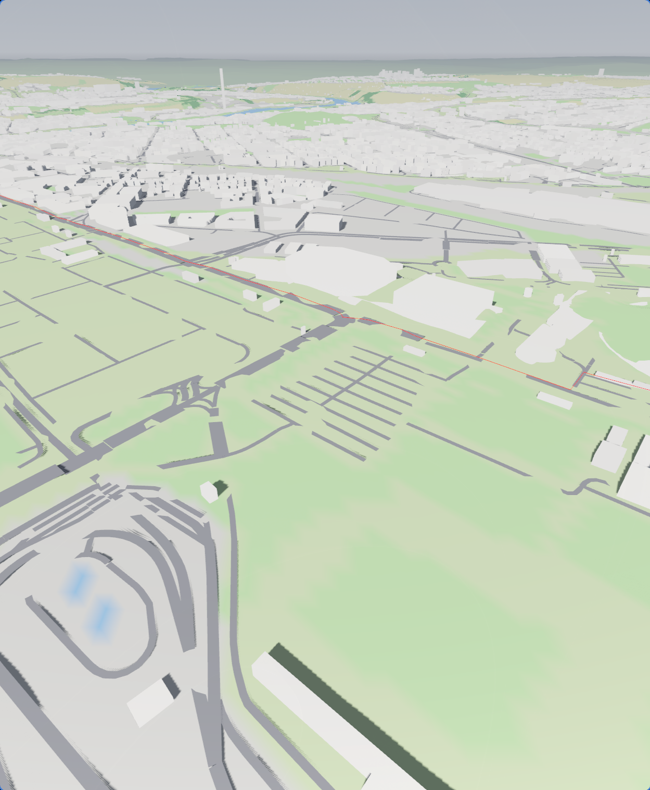
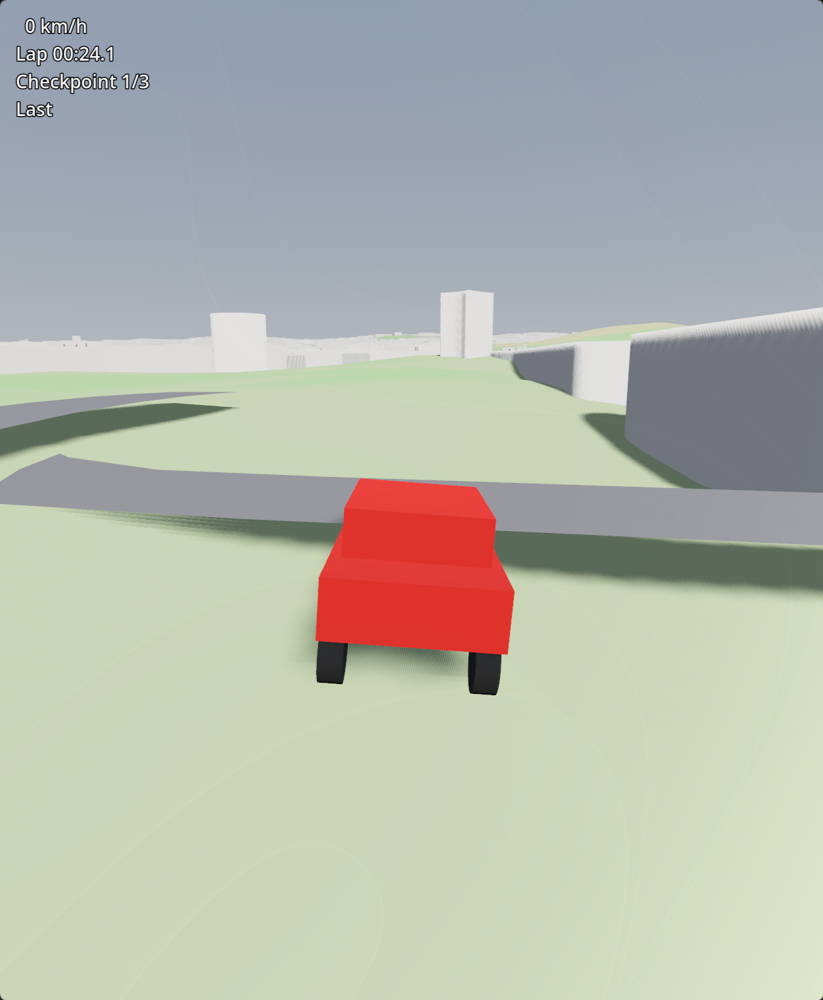

<!-- file generated with AI assistance: Claude Code - 2026-10-20 19:45:00 UTC -->

# Prototype spikes, 2026-10-20

Purpose: check the risky parts on a machine with a GPU before the main implementation moves to a machine where visual testing is hardly possible. Everything below was measured on a Ryzen AI 9 HX 370 / Radeon 890M (integrated), 64 GB RAM, Godot 4.7.2, Python 3.14.

Area: 10 × 10 km centred on 48.790, 9.200 (Stuttgart), covering the stadium in Bad Cannstatt, the city centre (Schlossplatz) and Killesberg. Route: OSRM demo server, stadium → Schlossplatz → Killesberg → stadium, 17.7 km.

## Results

| Spike | Result | Numbers |
|---|---|---|
| Data download | works, no accounts | Geofabrik Regierungsbezirk Stuttgart 212 MB, two Copernicus GLO-30 tiles 42 + 44 MB |
| OSM extract (pyosmium, one pass with areas) | works | 64 s; 20,644 road ways, 91,876 buildings, 5,549 land cover areas, 327 of them from multipolygon relations |
| Routing (OSRM public demo) | works | 17.7 km, 1,004 points, fully inside the area |
| Mesh build (`build.py`) | works | 35 s; 100 tiles, 1,650 km of road, 79,084 buildings in the area, 115 MB of glb |
| Godot runtime load (`GLTFDocument`) | works | 0.9 s without collision, 8.8 s with trimesh collision for all tiles |
| Car physics (headless smoke test) | works | settles, 0 → 50 km/h in about 4 s, steers, stays upright, brakes 30 → 0 in 1.2 s |
| Visual check (recognisable? roads on terrain?) | works in principle, very rough; road network visibly broken | see below |

## Visual check

Both scenes run on the integrated GPU. Verdict from the human tester: "works in principle, still very rough, roads do not seem to be connected throughout, fine for a first shot".

Recognisable: the stadium oval (bottom left), the Wasen, the Neckar, the TV tower on the horizon, the street grid of the city. The horizon mesh reads as distant hills. This GPU image is the reference for the software renders without a GPU described in the [README](../../README.md#screenshots-without-a-gpu), which use the Compatibility renderer and therefore look flatter.

Problems seen, with their cause:

- **Roads look dashed, with gaps.** Each way follows its own 100 m moving average of the DEM. Wherever the terrain (a DSM with tree and building bumps) is higher than that average, the terrain covers the road.
- **Roads float.** Where the terrain is lower than the average, the strip hangs in the air; the shadow under the road in the drive screenshot shows it.
- **Junctions do not connect.** Every way is smoothed on its own, so two ways meeting at one OSM node end up at different heights, and strips end with square cuts at angles.

Consequence for the main implementation (in this order):

1. Build a road graph: ways split at shared OSM nodes, one height per node, way heights interpolated between nodes and smoothed with node heights pinned.
2. Conform terrain to roads, not the other way round: stamp road heights into the terrain grid with a shoulder falloff; the road then sits flush and leaving it is no longer a step.
3. Junction meshes at graph nodes with degree ≥ 3; `motorway_link` ramps attach to the graph like any other edge.
4. Switch to a terrain model (DGM) as soon as the licence is checked; that removes most of the bumps at the source.

## Decisions that held up

- **Python for the data pipeline, GDScript in Godot.** The Godot build on this machine has no .NET, and the heavy lifting (OSM, DEM, triangulation) is far easier with pyosmium, shapely, rasterio and trimesh. Godot only loads glb and runs gameplay.
- **Regional PBF instead of the Overpass API.** One download, any number of re-extracts; a 100 km² city area is where Overpass tends to time out.
- **Local metric frame.** EPSG:25832 minus the area centre, X = east, Y = up, Z = −north, all done in `Frame` in `build.py`. Keeps coordinates within ±20 km, safe for 32-bit floats.
- **Vertex colours, one shared material.** Land cover is baked into terrain vertex colours, Godot overrides every mesh with one `StandardMaterial3D` using vertex colour as albedo. Textures can replace this later per layer.
- **Runtime glb loading** rather than the editor importer: no reimport after every pipeline run, nothing in `.godot/imported/`.
- **Headless smoke test** (`godot/tests/drive_smoke.gd`) as the regression check for a machine without a screen.

## Known rough spots (expected, not bugs)

- Junctions: road strips overlap, separated only by a small height offset per road class.
- Roads follow a 100 m moving average of the DEM, lifted 0.35 m. On steep streets the terrain can poke through or the road can float.
- Bridges and tunnels: straight height interpolation between the way's end points, no deck or tunnel geometry; tunnels are drawn on the surface.
- No trees yet; forest is a dark green ground colour.
- Buildings: footprint extruded, height from `height`, `building:levels` × 3 m + 1 m, or a default per `building` type. Flat roofs only.

## Risks for the main implementation

- **Copernicus GLO-30 is a surface model (DSM), not terrain.** Measured against DGM1 (see below): on average 2.9 m too high, 95th percentile 8.4 m, maximum 18.9 m, 45 % of the points more than 3 m off. That alone explains the dashed roads. Fix: DGM1 inside Baden-Württemberg, Copernicus only for the horizon.
- **Collision cost.** 8.8 s to build trimesh shapes for all 100 tiles. Needs streaming (collision only for tiles near the car) or precomputed shapes before the area grows.
- **Car on road edges.** The road strip floats 0.35 m above the terrain, so leaving the road is a small step down. Fine for a spike, wrong for a racing game: terrain under roads should be flattened to the road height instead.
- **OSRM demo server** is for testing only (usage policy); the planning mode needs a self-hosted OSRM or GraphHopper (Docker).

## DGM1 Baden-Württemberg (terrain model)

Checked 2026-10-20. Source: LGL Open GeoData portal, product list in `https://opengeodata.lgl-bw.de/assets/config/local/odp-products.json`.

- **Licence:** Datenlizenz Deutschland – Namensnennung 2.0 (dl-de/by-2-0), the licence PDF ships in every zip. Attribution: "Datenquelle: LGL, www.lgl-bw.de". Fine for a non-commercial game, also for redistributing derived meshes with that credit.
- **Download:** no account, plain HTTP: `https://opengeodata.lgl-bw.de/data/dgm/dgm1_32_<E>_<N>_2_bw.zip`, where `<E>`/`<N>` are the south-west corner in km in EPSG:25832. The 2 km grid starts at **odd** easting and **even** northing (`dgm1_32_515_5404` exists, `514_5404` and `515_5403` are 404).
- **Content:** one zip ≈ 12.6 MB holds four 1 km tiles as `.xyz` text (`easting northing height`, cell centres at .50, 1 m grid, 1,000,000 lines, 29 MB each), survey year in the file name (2023 here).
- **Reading:** `numpy.loadtxt` reads the four files in about 1 s. For the pipeline, convert to one GeoTIFF/VRT per area and sample it like the Copernicus raster.
- **Coverage for the spike area:** eastings 509–519, northings 5398–5408 → 6 × 6 = 36 zips, about 450 MB download, about 4 GB unpacked text (convert and drop the text).
- **Also in the portal, same licence and grid:** LoD2 buildings with roof shapes (`/data/lod2/`), DOP20 aerial images 20 cm (`/data/dop20/`, for textures later), nDOM1 normalised object heights (`/data/ndom1/`, gives tree heights for forest scattering).

Outside Baden-Württemberg the same products exist per state with different portals; Copernicus stays the fallback.

## Next steps

1. Main implementation on the remote build machine (orchestrated, no screen), starting with the road graph and terrain conforming above, then tile streaming with collision near the car. Regression check there: `drive_smoke.gd` plus pipeline statistics; visual checks come back to a machine with a screen.
2. Car feel with a gamepad is still untested; only keyboard so far.

## Result (stage A1)

The road network is now a graph with one height per node, smoothed DGM1 profiles per edge and flat junction surfaces, so all strips meet at the same height at every node instead of overlapping per way. How to build it and what every build reports (`metrics.json`/`metrics.md`, with the shared-heights gate) is described in the [README](../../README.md); adapting the terrain to the roads follows in stage A2.

## Result (stage A2)

The terrain is now conformed to the roads (`pipeline/conform.py`): flat at road ground height up to 15 m beyond every strip edge, blended back to DGM1 over 25 m, with a final pass that lowers single grid triangles where terrain would still show through. A second hard gate checks that the terrain stays at least 2 cm below every strip (Stuttgart build: 0 points below, clearance p50 0.20 m, minimum 0.05 m), and the road lift is down from 0.35 m to 0.1 m. Remaining: bridges and tunnels still have no deck or portal geometry, and the extreme grades in the slope table (data artefacts at a few ramps and stairs-like ways) are unchanged.

**A2.2a.** Node heights are now smoothed before the edges are sampled (`roads.build_road_network`): ground nodes may leave their DGM1 median by at most 2 m, portal and abutment nodes start from DGM1 on the ground side of the structure, node chords are relaxed to 22 % and drawn profiles to 24 %. Two new hard gates check the result: the largest grade of the drawn surface (Stuttgart build: 24.68 %, before 469.65 %; 571 sections above 12 % over 12.774 km, before 599 over 13.503 km; reasons structure_end 89, terrain 300, short_edge 47, osm 135) and the deviation of the 9245 ground nodes from the DGM1 median (p50 0.0, p95 0.0, max 2.0 m). The 380 structure nodes are listed only; the 272 portal and abutment nodes deviate by p50 0.61, p95 4.31, max 9.78 m. Only bridges and tunnels count as structures (bridge 179 edges in 81 chains, 11.54 km; tunnel 86 / 40 / 14.88 km); building passages (8 edges, 0.09 km), culverts (0) and covered ways (7 edges, 0.09 km) are ground roads. The route line now sits on the drawn road surface: 1038 of 1041 points snap to the nearest road segment (max 9.53 m, p95 5.06 m, 91 on a bridge or tunnel), 3 fall back to the conformed terrain; on the König-Karls-Brücke the line runs 2.3-6.0 m above DGM1, inside the Rosenstein and Leuze tunnels down to 26 m below it, and Godot draws it 0.3 m above the surface with depth test. Conform still cuts up to 23.39 m and fills up to 19.57 m (minimum clearance 0.05 m); tiles 110.1 MB, build about 27 s. Remaining for A2.2b/A2.2c: bridge decks and tunnel tubes have no geometry yet, and the conform pass still digs 15-40 m into tunnel portals and fills under bridge starts.

**A2.2b.** Bridges have geometry now (`pipeline/bridges.py`, mesh layer `bridges`). Where a bridge crosses another road at least 1 m below it, the deck is lifted to a clearance of 4.5 m under a 1.2 m deck, and where the deck cannot go that high between two fixed abutments, the ground road below gets a dip: of 81 such crossings in the Stuttgart build, 37 bridge edges were lifted by up to 4.42 m and 18 roads below dipped by up to 3.88 m, and the clearance under the deck went from 0.19 m at worst (Talstraße over the B10) to a minimum of 4.11 m (p50 4.59 m, 3 crossings below 4.5 m). Each 5 m bridge segment is `deck` (underside at least 0.5 m above DGM1; walkway, parapet, outer faces and underside, terrain kept on DGM1) or `low` (conformed like a ground road, no body): 1875 deck segments over 9.10 km, 439 low ones over 2.05 km. The conform pass no longer fills under bridge starts. At the 138 abutments the terrain triangles crossing the abutment line are pinned to the deck plane, which brings the step between deck ground and terrain from p50 3.42 m (without pins) to 0.34 m; only 10 abutments keep the plane exactly (p50 0.0, max 0.32 m), at the other 128 a road strip in the same 10 m terrain cells is lower and the push-down pass wins (p95 6.6 m, max 7.7 m, mostly bridges over a road running right past the abutment). The gate values are unchanged (largest grade 24.68 %, terrain clearance min 0.05 m); the lifted decks add 37 sections above 12 % next to abutments (608 over 13.02 km), tiles grow from 116.2 to 119.0 MB, the build stays at about 30 s. The smoke test now also drives over the König-Karls-Brücke. Remaining: a step-free abutment next to another road needs a finer terrain mesh there (local refinement or a cut along the abutment line), and the 0.05 m target holds only where no other road shares the terrain cells.

<!-- - revised 2026-10-20 (link to the software screenshots) -->
<!-- - revised 2026-10-21 (route on the road surface, A2.2a gates) -->
<!-- - revised 2026-10-21 (bridge decks, A2.2b) -->
